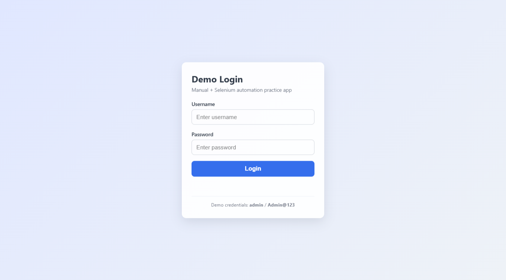
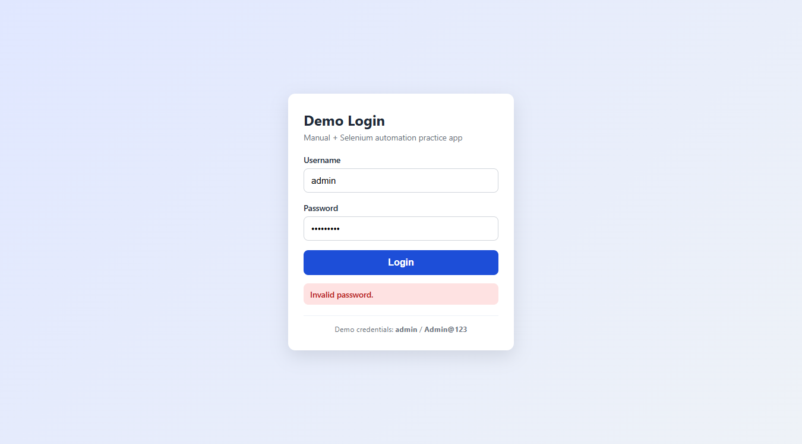
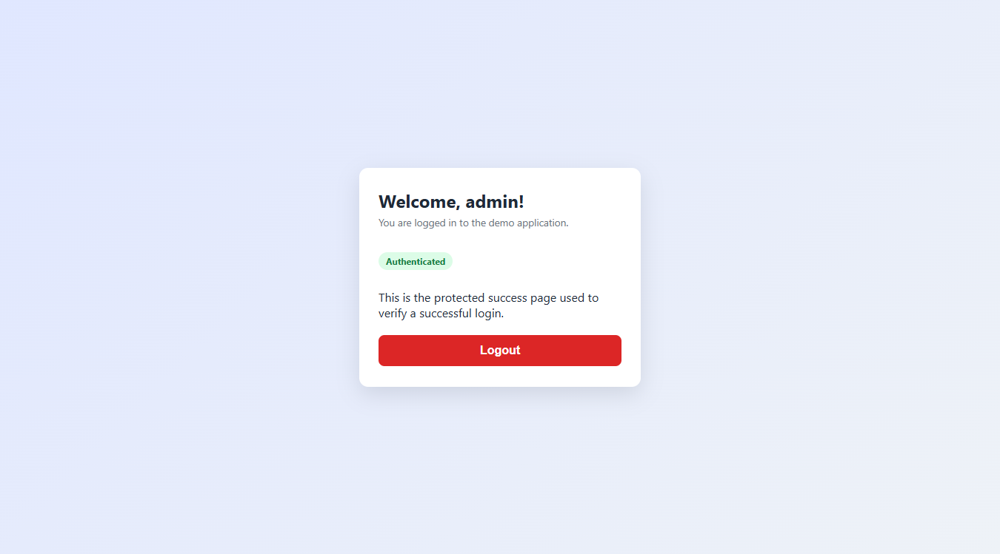

# Login Page Manual Testing and Automation Framework

A small, beginner-friendly **Digital Quality Engineer** portfolio project. It contains a
safe local demo login page, a complete manual testing package, and a working
Selenium WebDriver + TestNG automation suite driven by Maven.

> This is a learning/portfolio project. It uses only **dummy credentials**, has **no
> backend**, and does **not** connect to any real account or collect real data.

---

## 1. Project Objective

Demonstrate an end-to-end QA workflow on one small feature (a login page):

- Understand requirements and write a **test plan**.
- Design **manual test cases** (positive, negative, boundary, input-validation).
- Report defects using a **bug report template**.
- Automate the key scenarios with **Selenium WebDriver + TestNG + Maven**.
- Produce a **test execution report** and a **requirements traceability matrix**.
- Prepare for interviews with a dedicated `INTERVIEW_PREPARATION.md`.

## 2. Features Tested and Technologies

**Features tested (demo application)**
- Username + password login form with a Login button.
- Two documented dummy users; clear error messages for invalid input.
- Empty-field validation (both blank, username blank, password blank).
- Minimum-length boundary validation (username ≥ 3, password ≥ 6).
- Unknown username vs. wrong password error messages.
- Authenticated dashboard view showing the welcome message, e.g. **"Welcome, admin!"**
  (built in `app/script.js` as `"Welcome, " + username + "!"`).
- Logout returning the user to the login form.
- Password field masking; username trimming; Enter-key submit.
- Basic responsive styling (plain HTML, CSS, JavaScript).

**Automation / technology stack**
| Technology | Version | Purpose |
|------------|---------|---------|
| Java | 17 | Language (compiled with `release 17`) |
| Maven | 3.9.9 | Build & dependency management |
| Selenium WebDriver | 4.33.0 | Browser automation |
| TestNG | 7.11.0 | Test runner, annotations, assertions |
| Browser | Chrome 154 (primary); Edge 155 | Browsers used for the recorded run |

No database (MySQL), Spring Boot, or Docker is used — the project stays lightweight.

## 3. Folder Structure

```
LoginPageTestingProject/
├── app/                                  # The demo web application
│   ├── index.html                        # Login form + dashboard views
│   ├── style.css                         # Responsive styling
│   └── script.js                         # Validation + login/logout logic
├── src/test/java/com/qualitykiosk/login/
│   ├── base/BaseTest.java                # Per-test browser setup/teardown
│   ├── config/ConfigReader.java          # Reads config.properties
│   ├── listeners/TestListener.java       # Screenshot on failure
│   ├── pages/LoginPage.java              # Page Object for the login form
│   ├── pages/DashboardPage.java          # Page Object for the dashboard
│   ├── tests/LoginTest.java              # 7 login scenarios
│   ├── tests/LogoutTest.java             # 1 logout scenario
│   ├── utils/DriverFactory.java          # WebDriver creation
│   └── utils/ScreenshotUtil.java         # Screenshot helper
├── src/test/resources/
│   ├── config.properties                 # browser, headless, url, credentials
│   └── testng.xml                        # TestNG suite definition
├── docs/
│   └── screenshots/                      # Real app screenshots used in this README
│       ├── 01-login-page.png
│       ├── 02-invalid-password-error.png
│       └── 03-dashboard-after-login.png
├── MANUAL_TEST_CASES.csv                 # 15 manual test cases
├── BUG_REPORT_TEMPLATE.csv               # Defect template (with example row)
├── TEST_PLAN.md                          # Test plan
├── TEST_EXECUTION_REPORT.md              # Real execution results
├── REQUIREMENTS_TRACEABILITY_MATRIX.csv  # Requirement → test mapping
├── INTERVIEW_PREPARATION.md              # Interview notes + Q&A (English + Marathi)
├── README.md
├── pom.xml                               # Maven build file
└── .gitignore
```

## 4. Prerequisites

- **JDK 17** (`java -version` should report 17).
- **Apache Maven 3.9+** (`mvn -version`).
- **Google Chrome** or **Microsoft Edge** installed.
- Internet access on the **first** test run so Maven can download dependencies and
  Selenium Manager can fetch the matching browser driver.

Selenium 4.6+ downloads browser drivers automatically — you do **not** need to install
ChromeDriver or GeckoDriver manually.

## 5. How to Start the Local Login Page

**Option A — open the file directly (simplest):**

Double-click `app/index.html`, or from the project root:

```powershell
Start-Process "app\index.html"
```

**Option B — serve it over HTTP (closer to a real site):**

```powershell
python -m http.server 8000 --directory app
```

Then open <http://localhost:8000/index.html> in your browser.

If you use Option B for the automated tests, set the URL in
`src/test/resources/config.properties`:

```properties
app.url=http://localhost:8000/index.html
```

## 6. How to Run the Maven Tests

From the project root:

```powershell
# Run the whole suite (a Chrome window will open)
mvn test

# Run without opening a visible browser window (recommended / CI friendly)
mvn test -Dheadless=true

# Use Edge instead of Chrome
mvn test -Dheadless=true -Dbrowser=edge

# Compile only (no tests)
mvn -q clean test-compile
```

The suite is defined in `src/test/resources/testng.xml` and holds **8 automated tests**.

## 7. Where to Find Test Reports

After a run:

| Report | Path |
|--------|------|
| TestNG XML result | `target/surefire-reports/testng-results.xml` |
| Surefire text summary | `target/surefire-reports/*.txt` |
| Surefire HTML report | `target/surefire-reports/index.html` |
| Failure screenshots | `target/screenshots/` |

## 8. Screenshots

These are **real screenshots** captured from the running demo app. The files live in
`docs/screenshots/` and are embedded below with relative paths so they render on GitHub.

**1. Login page** — username and password fields with the Login button.



**2. Invalid password error** — the "Invalid password." message after entering a wrong password.



**3. Dashboard after successful login** — the authenticated view showing "Welcome, admin!".



## 9. Dummy Demo Credentials

These credentials are defined in `app/script.js` (`VALID_USERS`). They are **dummy values
committed on purpose** for the demo only — they do **not** belong to any real account and
grant no access to any real system.

| Username | Password | Notes |
|----------|----------|-------|
| `admin` | `Admin@123` | Used by the automation suite |
| `tester` | `Test@1234` | Second demo user |

Any other username/password combination is rejected by the client-side validation.

## 10. Manual Testing Coverage

`MANUAL_TEST_CASES.csv` holds **15 test cases** executed manually against the demo page:

| Category | Cases | Examples |
|----------|-------|----------|
| Positive | 3 | Valid login (01), logout (14), submit with Enter (15) |
| Negative | 5 | Wrong password (02), unknown username (03), empty fields (04–06) |
| Boundary | 4 | Username 2/3 chars (07–08), password 5/6 chars (09–10) |
| Input validation | 2 | Injection-style username (11), trimming spaces (12) |
| Security (client-side) | 1 | Password masking (13) |

Result: **15 PASS, 0 FAIL, 0 Not Executed.** Defects would be
logged using `BUG_REPORT_TEMPLATE.csv`. No backend/security testing is claimed.

## 11. Latest Test Execution Results

**Manual testing** — all 15 cases in `MANUAL_TEST_CASES.csv` confirmed **PASS**.

**Automation** — from the most recent `mvn clean test` run (Windows 10, Chrome 154, headless):

```
Tests run: 8, Failures: 0, Errors: 0, Skipped: 0
BUILD SUCCESS
```

The 8 tests are **7 in `LoginTest`** (valid login, wrong password, wrong username, empty
credentials, empty password, short password boundary, short username boundary) plus
**1 in `LogoutTest`** (successful logout). See `TEST_EXECUTION_REPORT.md` for the full
breakdown. This README-only update did not change or rerun the tests.

This is a client-side demo, so no backend or real server-side security testing is claimed.

## 12. Known Limitations and Future Improvements

- **Client-side only:** validation and credentials live in JavaScript, visible to anyone.
  This is a demo, not secure authentication.
- **User enumeration:** the app shows different messages for an unknown username vs. a
  wrong password. A real system should usually show one generic message.
- **No rate limiting / lockout** after repeated failed attempts.
- **No persistence:** refreshing the page logs you out.
- **CDP warning:** Chrome may be newer than Selenium's bundled DevTools protocol; the
  warning is harmless and does not affect results.
- **Single-threaded by default:** tests run sequentially unless configured otherwise.

### Future improvements

- Add a real backend with hashed passwords and server-side validation.
- Show one generic login error to remove user enumeration.
- Add account lockout / rate limiting after repeated failed attempts.
- Persist the session (e.g., a token) instead of resetting on page refresh.
- Add data-driven tests with TestNG `@DataProvider` and a Firefox cross-browser run.
- Run the suite in parallel and wire it into CI (e.g., GitHub Actions).

## 13. Troubleshooting

| Problem | Likely cause | Fix |
|---------|--------------|-----|
| `Demo application not found at ...` | Tests run from the wrong folder | Run `mvn test` from the project root, or set `app.url` in `config.properties` |
| Selenium Manager cannot download a driver | No internet on first run | Connect to the internet once, or install a matching driver manually |
| `Unable to find CDP implementation` warning | Browser newer than Selenium | Ignore — it does not affect the tests |
| Tests fail to find elements | `app.url` points to the wrong file | Verify the URL, or leave `app.url` empty for auto-detection |
| Need to run offline | Dependencies not cached | Run once online; afterwards Maven uses the local `~/.m2` cache |

## 14. Repository and How to Push Future Changes

This project is already published at:

**https://github.com/akshatab15/Login-Page-Testing-Automation** (public, branch `main`)

The local folder is already a Git repository connected to that remote, so **do not run
`git init` or `git remote add origin` again**. For future changes, just add, commit and push:

```powershell
# 1. Review what changed
git status

# 2. Stage only the files you changed
git add README.md          # or: git add . for everything

# 3. Commit with a clear message
git commit -m "Update README"

# 4. Push to the existing remote (no -u needed after the first push)
git push
```

Notes:

- If `git push` asks for credentials, complete the **Git Credential Manager** browser
  sign-in once; it is then remembered.
- Confirm `origin` points to the right URL with `git remote -v`.
- Never commit `target/`, generated reports, browser drivers, or real secrets — `.gitignore`
  already excludes them.
- Re-running `git init` or adding a second remote is unnecessary and can cause confusion.

## 15. Repository Description and Topics

Suggested GitHub description (the "About" field):

> Beginner-friendly QA portfolio project: a local demo login page with 15 manual test cases
> (all passing) and 8 Selenium + TestNG + Maven automated tests using a Page Object Model.

Suggested topics:

`selenium` · `testng` · `java` · `maven` · `qa` · `manual-testing` · `automation-testing` ·
`page-object-model` · `software-testing` · `portfolio-project`

To set them manually: open the repository page, click the gear icon next to **About**, paste
the description, and add the topics.

> Do not commit browser drivers, generated reports, or any personal credentials.
